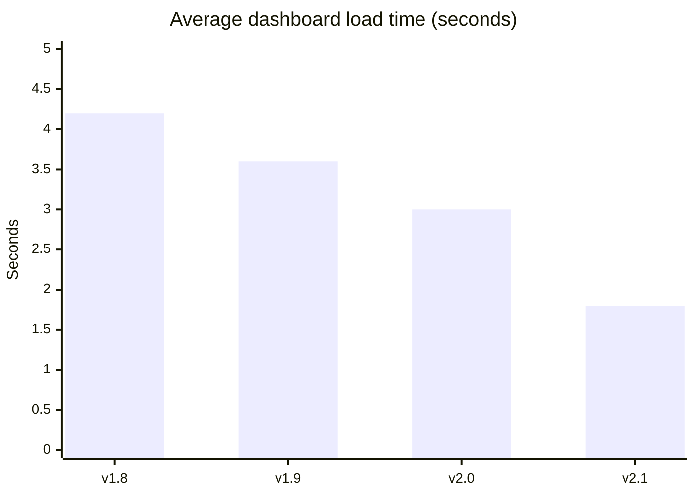
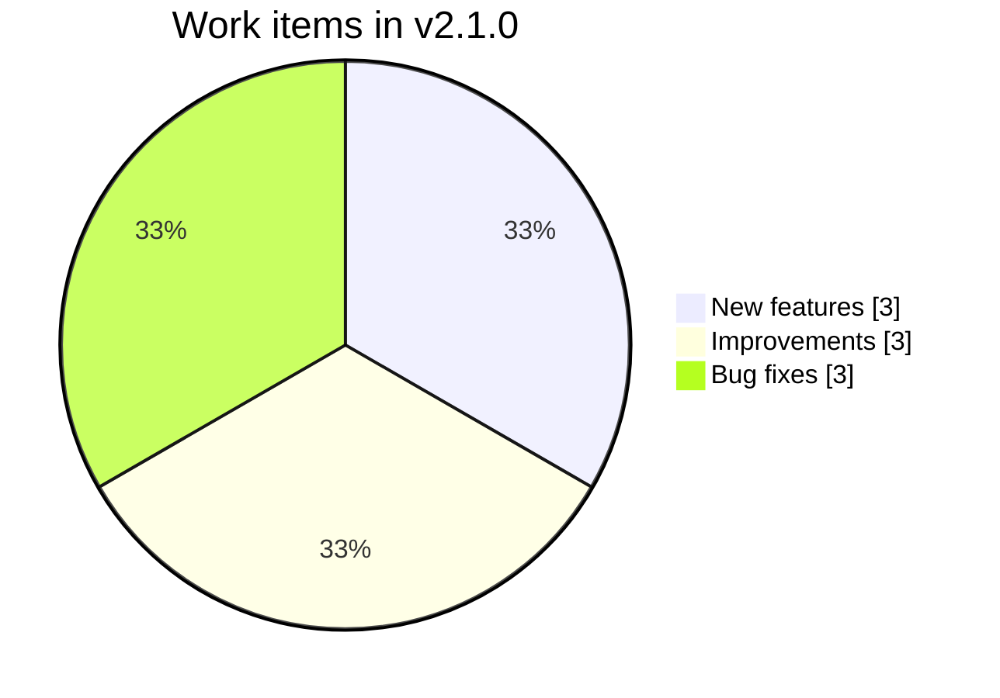
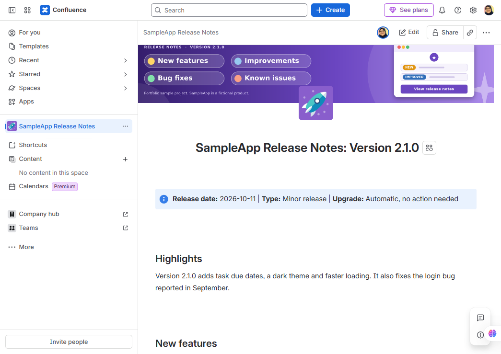
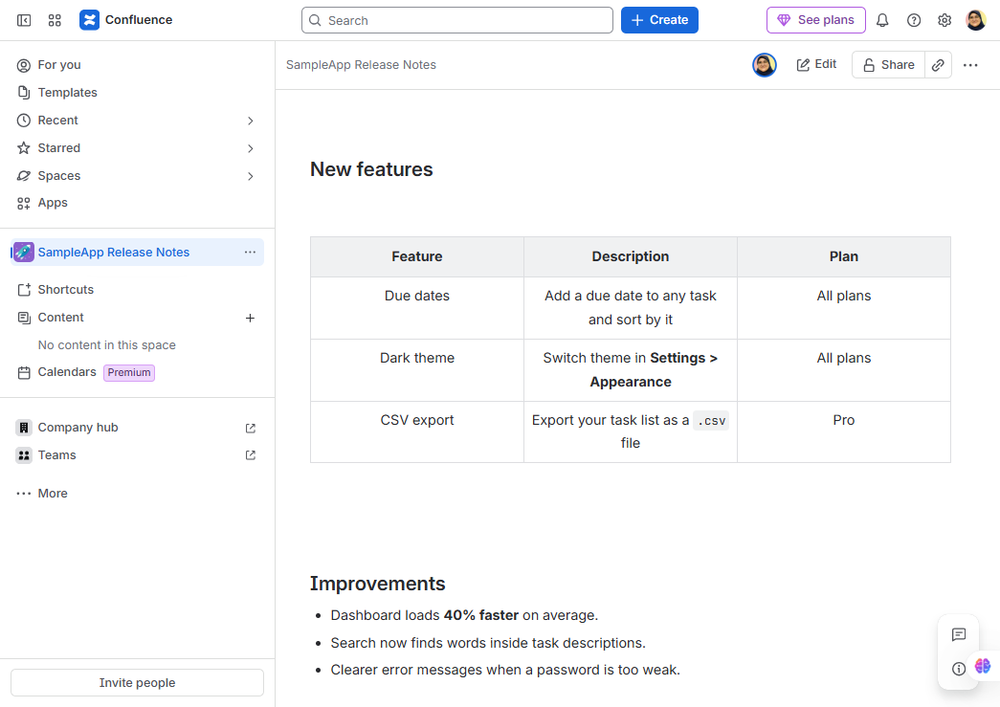
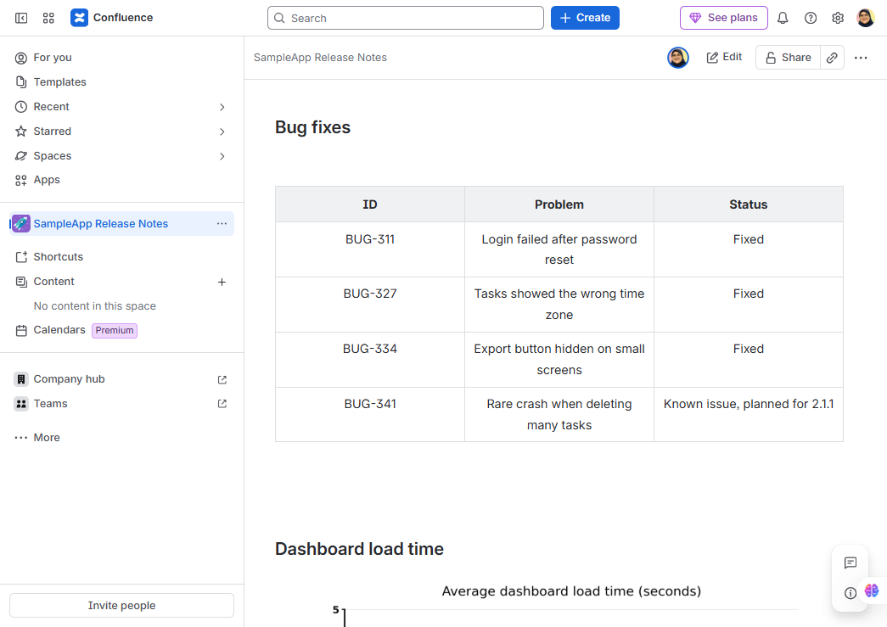
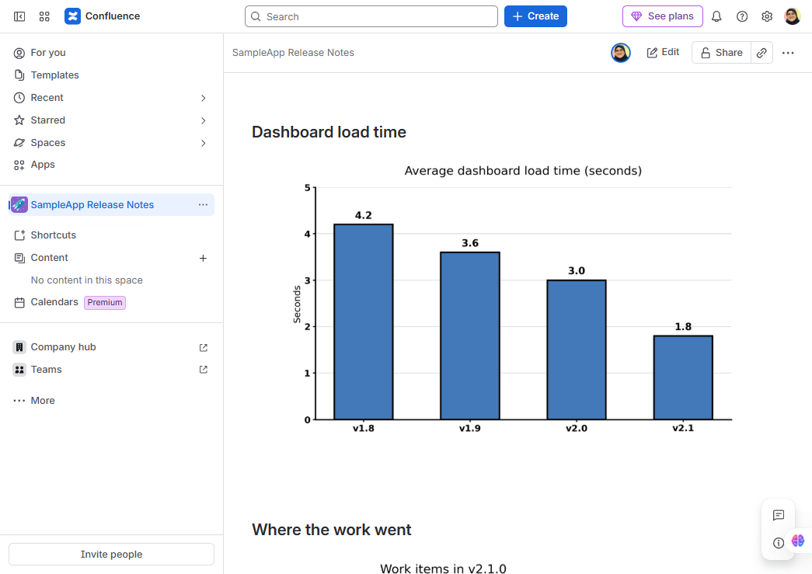
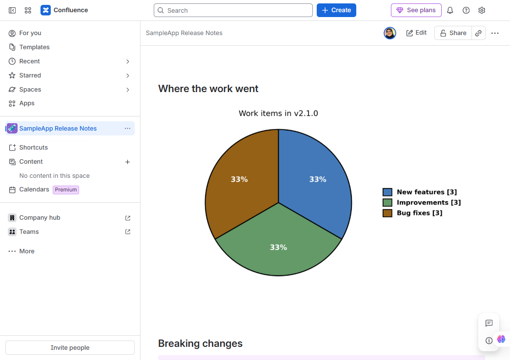
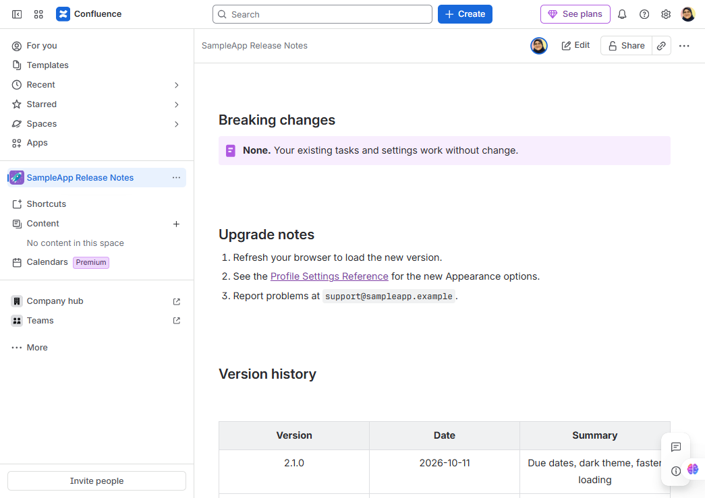
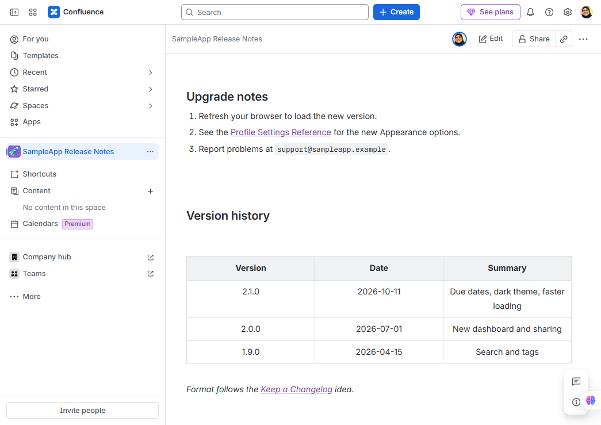

# SampleApp Release Notes: Version 2.1.0

[View screenshots of the Confluence page](#screenshots-of-the-confluence-page)

**Release date:** 2026-10-11  |  **Type:** Minor release  |  **Upgrade:** Automatic, no action needed

## Highlights
Version 2.1.0 adds task due dates, a dark theme and faster loading. It also fixes the login bug reported in September.

## New features
| Feature | Description | Plan |
|---------|-------------|------|
| Due dates | Add a due date to any task and sort by it | All plans |
| Dark theme | Switch theme in **Settings > Appearance** | All plans |
| CSV export | Export your task list as a `.csv` file | Pro |

## Improvements
- Dashboard loads **40% faster** on average.
- Search now finds words inside task descriptions.
- Clearer error messages when a password is too weak.

## Bug fixes
| ID | Problem | Status |
|----|---------|--------|
| BUG-311 | Login failed after password reset | Fixed |
| BUG-327 | Tasks showed the wrong time zone | Fixed |
| BUG-334 | Export button hidden on small screens | Fixed |
| BUG-341 | Rare crash when deleting many tasks | Known issue, planned for 2.1.1 |

## Dashboard load time

## Where the work went

## Breaking changes
**None.** Your existing tasks and settings work without change.

## Upgrade notes
1. Refresh your browser to load the new version.
2. See the [Profile Settings Reference](https://github.com/mai-aamer/profile-settings-reference) for the new Appearance options.
3. Report problems at `support@sampleapp.example`.

## Version history
| Version | Date | Summary |
|---------|------|---------|
| 2.1.0 | 2026-10-11 | Due dates, dark theme, faster loading |
| 2.0.0 | 2026-07-01 | New dashboard and sharing |
| 1.9.0 | 2026-04-15 | Search and tags |

*Format follows the [Keep a Changelog](https://keepachangelog.com/) idea.*

## Screenshots of the Confluence page

These release notes were designed and published in Confluence. The screenshots below show the final page, from top to bottom.

